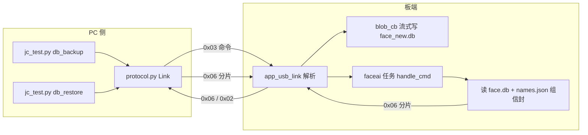

## 产品概述

为边缘人脸识别设备（jc_p4_app）增加"特征库备份与恢复"能力：把设备上已注册的全部成员（名字 + 人脸特征）一键导出成一个备份文件保存到电脑，之后可随时把备份原样导回设备，实现整机迁移与防丢。面向"设备换新、固件重刷、多人库集中管理"等场景。

## 核心功能

- 一键导出：设备把名表与特征库整体打包，经现有网线/USB 链路分片传到电脑；电脑侧校验完整后落盘为单个备份文件，并可直接看到备份了多少位成员。
- 一键恢复（覆盖式）：把备份文件回传到设备；恢复后成员名单与名字和备份时逐位一致（id 与名字映射不变，可跨设备迁移）。
- 防误操作：恢复前自动把设备上现有库另存一份回滚副本，误操作后可人工找回。
- 完整性保护：备份带总长度与校验和，分片带偏移量；长度或校验不符时整批拒绝，设备上的库保持原样。
- 互不影响：备份/恢复期间设备仍能正常输出识别结果；不改变既有命令与结果帧语义，原有电脑脚本与显示界面无需改动。

## 技术栈

- 固件：ESP-IDF v5.5.5，C++（`main/app_faceai.cpp`）、C（`main/app_usb_link.c/h`），cJSON，`/storage` FAT + wear-levelling
- PC 工具：Python 3.14 标准库（`pc_host/protocol.py`、`pc_host/jc_test.py`），与板端共用 JCLINK v1 协议
- 协议：JCLINK v1 新增帧类型 `0x06`（DB 块传输，双向分片），既有 0x01~0x05 语义不变

## 实现方案

### 关键决策

1. **传输通道改用新增的 0x06 帧类型**，而非规划文档里"0x02 分片回 JSON"的朴素做法。理由：0x02 是每帧都在流的结果通道（会互相污染、PC 需复杂过滤）；0x03 命令受 `CMD_JSON_MAX=256` 限制，传 656KB 需数千次往返；且 base64 会额外膨胀 33%。0x06 每帧可载荷至 `JCL_MAX_PAYLOAD`（1MB），几十帧即可完成。
2. **备份用二进制信封，不做 base64/JSON 包装**：名表 JSON 原文 + `face.db` 原始字节直传，恢复后与备份时逐位一致，满足"原样打包"的澄清结论，也便于 CRC32 整体校验。
3. **导入流式落盘**：PC 发 `db_import` 声明 `size`/`crc32` 后连续发分片，板端回调按累计偏移直接写入 `/storage/face_new.db`（头部 16B 与名表段另存小缓冲），**不申请大 PSRAM 缓冲、不跨核共享内存**——顺带绕开廿一节的"跨核 L1 不一致"坑。
4. **覆盖式恢复 + 自动回滚副本**：`db_import` 第一步就把现有 `face.db`/`names.json` 复制为 `/storage/face_bak.db`、`/storage/names.bak`；导入成功则删旧 `face.db` 并 rename 新文件替换；失败则删除临时文件、库不变。
5. **文件名一律 8.3 安全**（`face_new.db`/`face_bak.db`/`names.bak`）：F9 踩过"4 字符扩展名在 FATFS 未开 LFN 时静默失败"，不再引入新的 LFN 依赖。

### 协议与数据格式（关键契约）

```
/* 0x06 载荷（双向，小端）：4 字节偏移 + 该片数据 */
offset(u32 LE) | data

/* 备份信封（PC 侧 .bin 文件 = 所有 0x06 数据按 offset 拼接） */
magic     "JCDF"      4B
ver       u32 = 1
face_len  u32      /* face.db 字节数 */
names_len u32      /* names.json 原始字节数 */
names     names_len 字节   /* 原样来自 /storage/names.json */
face      face_len 字节    /* 原样来自 /storage/face.db   */
```

板端导出：`{"cmd":"db_export"}` → 读两文件构造信封到 PSRAM（上限 2MB）→ 算总长与 CRC32 → ack 带 `size/crc/parts/chunk` → 按偏移连续发 `parts` 个 0x06 分片。
板端导入：`{"cmd":"db_import","size":N,"crc":C}`（ack + 自动 .bak）→ 收分片流式落盘 → `{"cmd":"db_import_end"}`（校验长度与 CRC32 → 替换 → 重建特征库 → 复位缓存 → 返回 `lib`/`lib_feats`）；另有 `db_import_abort` 与"新 begin 覆盖旧会话"的兜底。

### 可靠性与性能

- 复杂度：导出 O(文件字节数)，导入 O(字节数) + 一次读回校验；分片 8~32KB，最坏 656KB（64 人 × 5 特征）约 21~80 帧，TCP 下亚秒级。
- 校验：每帧 JCLINK CRC16 + 整包 CRC32 + 长度断言，任一项不符整批拒绝、库不变（先写 `face_new.db`，最后才替换）。
- 上限：`size` 拒绝大于 2MB；分片数上限 1024；导入期间 0x02 结果帧继续流，PC 侧按类型过滤即可。
- 向后兼容：板端接收分发新增分支；**已核实 WSL 模拟器 `net_link.c` 的 `dispatch()` 对未知类型是 `default: break;`（静默忽略）**，`board_hub.py` 为透明转发，旧脚本 `Link.recv` 默认 `want` 不含 0x06 同样忽略——即新增类型不会打断任何既有链路。

### 架构设计



- 板端发送复用 `app_usb_link_send(JCL_TYPE_BLOB, ...)`（已有 `t_tx_lock` 保证整帧不交错）；接收新增 `app_usb_link_set_blob_cb(cb)`，回调在 rx 任务上下文，仅做顺序写入（非阻塞、不分配大内存）。
- `s_db` 的替换、名表写入、缓存复位全部在 faceai 任务内完成（沿用"命令跑在 AI 任务"的既有纪律），避免与识别路径并发。

## Implementation Notes

- **回调纪律**：blob 回调运行在 USB/TCP 接收任务里，只允许"校验偏移 + fwrite/小缓冲拷贝"，禁止阻塞、禁止调用发送接口、禁止访问 `s_db`。
- **缓存复位清单**（导入成功后照抄 clear/delete 的复位）：`smooth_reset()`、`s_trk_ok=false`、`s_evt_match_name[0]=0`、`s_evt_match_us=0`、`s_evt_rej_us=0`、`s_multi_cache_n=0`、`s_lib_dirty=true`。
- **避免跨核共享缓冲**：导入走 VFS 落盘，不经 `app_imgpipe` 帧池，不需要 C2M/M2C 维护（这是有意的设计约束）。
- **日志**：迁移/失败路径用 `ESP_LOGW/LOGE` + `app_usb_link_log()` 报一行摘要，禁止打印 payload 内容与大块数据。
- **不扩大爆炸半径**：不改 0x01~0x05 语义、不改 `CMD_JSON_MAX`、不改结果帧字段（仅导入/导出完成帧额外带既有 `lib`/`lib_feats`）。
- **环境**：`pc_host` 在工作区根目录 `D:\esp32project\ESP32-P4\pc_host\`；改 Kconfig 后需 `idf.py reconfigure`；烧录前 `chcp 65001` + `PYTHONIOENCODING=utf-8`；板端只服务一个 TCP 客户端（hub 未跑时脚本直连 `192.168.33.2:3333`）。

## 目录结构

```
ESP32-P4/
├── jc_p4_app/
│   ├── main/
│   │   ├── app_usb_link.h    # [MODIFY] 新增 JCL_TYPE_BLOB 0x06 常量与 app_usb_link_set_blob_cb() 声明
│   │   ├── app_usb_link.c    # [MODIFY] 接收分发 ST_CRC1 增加 0x06 分支（调用 blob_cb）；保存/清理回调指针
│   │   └── app_faceai.cpp    # [MODIFY] 新增 db_export / db_import / db_import_end / db_import_abort 命令：
│   │                         #   信封构造与分片发送；导入前 .bak 备份；按偏移流式落盘 face_new.db；
│   │                         #   CRC32+长度校验；替换 face.db、写入名表、重建 DataBase、复位识别缓存
│   └── docs/
│       ├── usb_link_protocol.md   # [MODIFY] 帧类型表新增 0x06 及其载荷格式（offset+data）
│       ├── HANDOVER.md            # [MODIFY] 新增 F10 小节 + 文首待办/机器现状/改动总表同步
│       └── face_recog_day_plan.md # [MODIFY] 标记 F10 完成、第 3 轮收口
└── pc_host/
    ├── protocol.py           # [MODIFY] T_BLOB=0x06、TYPE_NAME 补项、send_blob()/recv_blob()
    ├── jc_test.py            # [MODIFY] 新增 db_backup FILE / db_restore FILE 子命令（导出落盘、导入回传、CRC 校验与进度）
    └── _f10_test.py          # [NEW] 一次性验收脚本：注册→备份→清库→恢复→名单一致→识别仍 match；
                              #   以及 CRC/尺寸不符被拒且库不变、/storage 生成 .bak 的负向用例
```

## Agent Extensions

### SubAgent

- **code-explorer**
- Purpose: 在动 0x06 之前，把所有 JCLINK 帧类型的分发/解析点一次性排查干净（板端 `app_usb_link.c` 的 parser 分发、`pc_host/protocol.py` 的 `recv`/`recv_any`、WSL 模拟器 `net_link.c` 的 `dispatch`、`board_hub.py` 的转发路径），确认"新增 0x06 不会打断任何既有链路"。
- Expected outcome: 给出帧类型分发点清单与逐点结论（忽略/透传/需改），作为 0x06 落地的兼容性依据。

### Skill

- **lsp-code-analysis**
- Purpose: 精确核对 `app_usb_link_send/set_cmd_cb`、`dl::recognition::DataBase`（构造/析构/`get_num_feats`）与 `names_save` 的定义与全部调用点，避免改动签名或破坏其它调用方。
- Expected outcome: 关键 API 的签名与调用点清单，确认新增 `set_blob_cb` 与重建 `s_db` 不会影响既有调用路径。