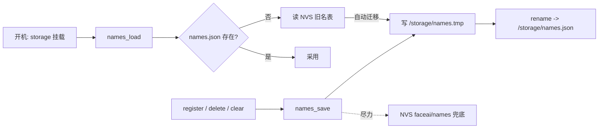

## 产品概述

为边缘人脸识别设备（jc_p4_app）提升名表容量：把设备端「名字表」的持久化从 NVS 2048B 字符串迁移为 `/storage/names.json`（NVS 保留兜底），人数上限由 10 人提升到 64 人，使模拟器 UI 的名单管理（注册/删除/查看列表）在更大规模下仍可用。

## 核心功能

- 名字表持久化迁移到 `/storage/names.json`；首次开机自动把已有 NVS 旧名表（格式 `"1:user1;2:user2"`）迁移进 names.json，NVS 保留兜底，升级不丢已注册的人。
- 人数上限 10 → 64，特征条数上限 32 → 约 320；注册达到上限时报 `lib full`。
- 保持现有协议语义完全不变：结果帧 `lib` / `lib_feats` 数组、`list` 事件、`start/register/delete/clear` 行为与回归脚本断言兼容。
- 名单在结果帧（`lib_n`）与模拟器 UI（`lib: name(N)`）中正确展示更多成员。

## 技术栈

- 语言/运行时：ESP-IDF v5.5.5，C++（现有 `main/app_faceai.cpp`）
- 序列化：cJSON（工程已在用，结果帧/命令解析）
- 存储：`/storage` = ~8MB FAT 分区（partitions.csv: `storage,data,fat,0x810000,0x7F0000`），经 wear_levelling 挂载（`esp_vfs_fat_spiflash_mount_rw_wl`，`format_if_mount_failed`）
- 兜底：NVS（namespace `faceai` / key `names`）

## 实现方案

核心：在 `app_faceai.cpp` 内把「名表」持久化从 NVS 字符串改为 `/storage/names.json`，NVS 仅作只读兜底，并把人数/特征上限提升到 64/320。

加载流程（在 storage 挂载之后）：

1. 挂载 `/storage`（FAT + WL，已有代码）；
2. 读 `/storage/names.json`（cJSON 解析数组 `[{id,name}...]`）→ 成功则采用；
3. 若不存在/解析失败 → 回退读 NVS 旧名表；
4. 若来自 NVS 且 names.json 缺失 → 立即写 names.json（自动迁移）并打 0x04 日志；
5. 两者皆空 → 空名表。

保存流程（register 成功 / delete / clear 触发）：

- cJSON 生成数组 → 写 `/storage/names.tmp` → `rename` 到 `/storage/names.json`（FAT 原子替换，防掉电半截）；同时尽力同步 NVS 字符串兜底（超过 NVS 单值长度则告警跳过，不阻断主路径）。

关键决策与权衡：

- 用文件而非继续扩 NVS：IDF NVS 字符串单值上限约 4000B，64 个名字（含长名）会撑破，且文件无硬长度限制、更利于 F10 备份导出；代价是 NVS 兜底不保证写入成功（可接受，仅兜底）。
- tmp+rename 原子写必须做：names.json 损坏会导致全部名字丢失（特征数据仍在 `face.db`，但无法命名）。
- 上限取值 64/320：按每特征 2050B，64×5≈0.65MB，8MB 分区充裕；RAM 名表 320×sizeof(face_name_t)≈12KB，可接受。

## 实现要点（执行细节）

- 加载时机（必须改）：当前 `names_load()` 在 `app_faceai_init()` 里、早于 `faceai_task` 内的 storage 挂载（`app_faceai.cpp:2650` vs `:2504-2520`）。F9 必须让名表加载发生在挂载之后（把挂载上移到 `app_faceai_init` 中 `names_load()` 之前，或将 `names_load()` 移入 `faceai_task` 挂载之后）——否则 names.json 永远读不到。
- `register` 的 `lib full` 判定（`app_faceai.cpp:1997` 的 `name_count_persons() >= MAX_PERSONS`）改用新上限（走 Kconfig）。
- 名表内容与 `lib` / `lib_feats` / `list` 输出语义保持不变（`app_faceai.cpp:722-749`），回归脚本 `pc_host/_face_r1_test.py` 依赖这些断言。
- 上限尽量走 Kconfig（项目风格），改后必须 `idf.py reconfigure` 再 build；`sdkconfig` 与 `sdkconfig.defaults` 两处同步。

## 性能与可靠性

- 名表操作均为 O(N) 线性（N≤320），仅在开机/注册/删除/清库发生，**不在每帧热路径**（不由 `handle_frame` 调用），无帧率影响。
- names.json 只在库变更时写盘（FAT + wear_levelling），写放大可忽略；原子写保证要么旧版要么新版。
- NVS 兜底写入失败只告警不阻塞，主路径（names.json）始终可用。

## 架构设计

无新增模块、无新增源文件。改动集中在名表持久化层（`names_load`/`names_save` 重写 + 上限常量）+ Kconfig 两个上限项。数据流：



## 目录结构

```
jc_p4_app/
├── main/
│   ├── app_faceai.cpp        # [MODIFY] 名表持久化重写（names.json 读写 + NVS 兜底 + 自动迁移 + 原子写）、上限常量提升、加载时机调整
│   └── Kconfig.projbuild     # [MODIFY] 新增 APP_FACEAI_MAX_PERSONS（默认 64）/ APP_FACEAI_MAX_FEATS（默认 320），并调整 NVS 兜底串长度上限
├── sdkconfig                 # [MODIFY] reconfigure 生成并固化新符号
├── sdkconfig.defaults        # [MODIFY] 新符号默认值（对全新 sdkconfig 生效）
└── docs/
    ├── HANDOVER.md           # [MODIFY] 回写 F9 实现/验收/踩坑
    └── face_recog_day_plan.md# [MODIFY] 进度标记 F9 完成
```

## 关键数据结构

`/storage/names.json`（cJSON 数组，字段名稳定，供 F10 备份导出复用）：

```
[
  {"id": 1, "name": "musk"},
  {"id": 7, "name": "me"}
]
```

id = esp-dl DataBase 自增 id，同名多条特征即多行，与现有 `s_names` 语义一致。`face_name_t {uint16_t id; char name[32];}` 结构不变。