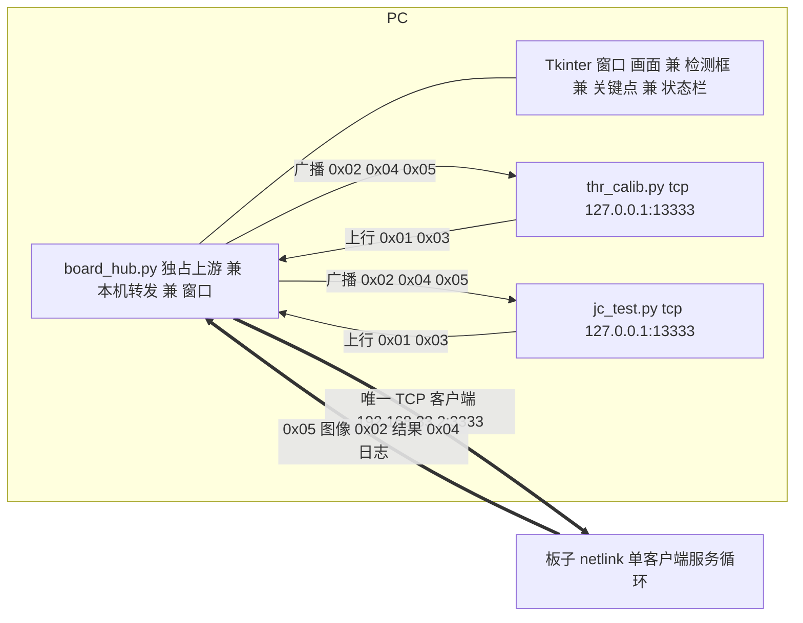

## 用户需求

写一个 PC 端 Python 程序，实时显示板载摄像头采集的画面。硬性要求：**板子在任何状态下都不中断画面**。当前 WSL 模拟器当取景器不好用 —— 它占住板子唯一的 TCP 客户端，一旦运行 A/B 标定脚本画面就断，导致调试极其困难。

## 产品概述

一个常驻本机的"取景中枢"进程：它独占板子唯一的 JCLINK TCP 连接，在本机另开一个同协议端口做透明转发（并可广播给多个本地客户端），同时用桌面窗口持续显示画面并叠加检测信息。现有脚本一行不改，只需把 `--tcp` 指向本机端口，即可在采集 A/B 数据的同时全程看到画面。

## 核心功能

- **常驻画面窗口**：实时显示 0x05 图像帧（JPEG 优先，兼容 RGB565 原始帧）；板子重启、拔网线、停流、分辨率或帧率变化时窗口不退出，保留最后一帧并显示状态，随后自动重连恢复画面
- **透明转发与本机多客户端**：本机监听一个端口，把本地脚本的 0x01/0x03 帧原样转发给板子；把板子的 0x02/0x04/0x05 帧广播给所有本地客户端（可同时跑多个脚本，画面照常刷新）
- **画面叠加**：检测框、5 个关键点（固件 `DIAG_KP` 开启时）、状态栏（event、sim、sim_raw、fps、infer_ms、lib_n、src、faces、stable）
- **保流与自愈**：上游断开自动重连并退避；图像停流超过阈值且近期无本地命令时自动补发 `stream on`（带冷却，不与脚本的 `stream off` 打架）
- **窗口交互**：缩放 1x/2x/3x、检测框与关键点与文字开关、手动截图、退出快捷键；另有**无界面自检模式**便于脚本化验收

## 技术栈

- Python 3.14.0（本机已装）
- **Tkinter**（标准库，窗口）+ **Pillow 12.3.0**（JPEG 解码、缩放、画框画点写字）+ **numpy 2.4.3**（RGB565 向量化展开）—— 三者均已实测可用
- 协议层**复用 `pc_host/protocol.py`，不改动**：`FrameParser.feed`（字节流自同步 + CRC 校验 + 坏帧跳过）、`ImageFrame`（0x05 八字节头解析）、`build_frame`/`crc16_ccitt`、`MAX_PAYLOAD` 1MB
- 网络与并发：标准库 `socket` / `threading` / `queue` / `argparse`
- 说明：cv2 5.0.0 虽然也可用，但已按用户选择走 Tkinter+Pillow；记忆里"OpenCV 未装"已过期，需更正

## 实现方案

**核心策略：单连接独占 + 本机代理 + 单向广播 + 最新帧渲染。**

- 上游：`board_hub.py` 是唯一连到 `192.168.33.2:3333` 的客户端，独占连接。
- 下游：监听 `127.0.0.1:13333`；本地脚本把 `--tcp 127.0.0.1:13333` 当作板子使用，协议完全一致（`Link.__init__` 用 `tcp.partition(":")` 解析 host:port，本机地址天然可用，所以脚本零改动）。
- 渲染：窗口只消费"最新一帧"，旧帧直接丢弃（不排队），保证内存有界、延迟恒定。

**关键决策与理由：**

1. **为什么必须是代理中枢**：板端 `app_netlink.c` 是 `listen(backlog=1)` 加单客户端 serve 循环，一次只服务一个客户端；画面与脚本各自连一次必然把对方挤进 backlog（表现就是 connect 成功却一帧都收不到）。只有同一进程独占上游，才可能"测 A/B 时画面不断"。
2. **为什么本地侧做广播**：脚本会在采集过程中连接或断开，而画面必须始终在；广播让"窗口"与"任意多个脚本"互不影响。
3. **为什么 Tkinter+Pillow**：标准库窗口、零额外安装、对线段与文字叠加友好；主线程跑 mainloop，网络与解码放后台线程，避免窗口卡死。
4. **保流门控**：仅当"上游在线 且 连续 N 秒未收到 0x05 且 距上次转发 0x03 命令超过 M 秒"才补发 `stream on`，并设冷却，避免与 `jc_test.py` 的 `stream off`、`thr_calib` 流程打架。
5. **不改现有脚本**：`jc_test.py`、`thr_calib.py`、`_face_r1_test.py`、`night_accept_test.py`、`ae_accept_test.py` 等保持原样，改的只是用户命令行里的 `--tcp` 值。
6. **性能**：只保留最新帧，raw 帧 614KB 不累积；默认 `stream fps=10`（文档记录 10fps 回传仅吃掉摄像头 10/50 帧，对 AI 影响小）；Pillow 的 resize 与 numpy 转换都是 C 级实现，10fps 开销可忽略。

## 架构设计



## 目录结构

```
ESP32-P4/
└── pc_host/
    └── board_hub.py     # [NEW] 取景中枢。唯一职责：独占板子上游连接 + 本机同协议端口转发（多客户端广播）+ Tkinter 画面窗口。
                         #   实现要求：(1) 上游连接与断线重连退避状态机；(2) 本地 accept 与每客户端读线程，上行字节经写锁串行发往板子；
                         #   (3) 上游字节同时广播给所有本地客户端；(4) FrameParser 解析出 0x05 更新最新帧、0x02 更新最新结果；
                         #   (5) Pillow 解码 JPEG / numpy 展开 RGB565，叠加 boxes 与 kp 与状态栏文字；(6) stream 保活门控（冷却 + 无本地命令窗口）；
                         #   (7) CLI：--board/--bind/--port/--fps/--fmt/--zoom/--selftest；(8) 窗口快捷键：1/2/3 缩放、b 框、k 关键点、t 文字、s 截图、q 退出；
                         #   (9) --selftest 无界面自检：连上游、开 stream、等够若干 0x05 与一条 0x02，打印统计后退出（0 为正常）
└── jc_p4_app/
    └── docs/
        └── HANDOVER.md  # [MODIFY] 第廿一节：新增本工具用法与显示字段说明；把"取景器自动交接（pkill 模拟器再重启）"的旧流程改为指向 board_hub.py；
                         #   明确纪律：今后取景与调试一律连本机端口，不用 WSL 模拟器占连接；同时更正 OpenCV 已安装等环境事实
```

（`pc_host/protocol.py` 与所有既有脚本均**不修改**。）

## 关键实现细节

- **线程模型**：T1 上游读线程（收字节、解析、更新共享状态、广播原始字节给本地客户端）；T2 本地 accept 线程，每个本地客户端一个读线程把上行字节写入上游；主线程跑 Tkinter mainloop，按约 30 至 60 Hz 轮询共享状态重绘。
- **共享状态**：最新 `ImageFrame`、最新结果 dict、上游连接状态、计数器（收帧、丢帧、图像 fps、本地客户端数）；用锁保护，图像用"只留最新"的语义传递。
- **上游写路径**：所有上行字节（来自任意本地客户端或 hub 自身的保流命令）经一把写锁串行发送；发送异常一律转为"标记断线并触发重连"，绝不抛到 UI 线程。
- **断线状态机**：连接中、在线、断开退避（1s 起步、上限 5s）；每次重连成功后重新下发一次 `stream on`（fps 取 `--fps`，默认 10；fmt 取 `--fmt`，默认 jpeg）。
- **叠加绘制**：用结果里的 `boxes`（x0,y0,x1,y1）画矩形并标注姓名或 event 与 sim；若结果带 `kp`（10 个整数、5 个点）则画点与连线；状态栏一行显示 event、sim、sim_raw、fps、infer_ms、lib_n、src、faces、stable 加本地侧统计。取景时可凭状态栏与框宽直接对齐"脸宽 200 至 320px"的目标。
- **编码与终端**：Windows 中文环境启动时设置 `PYTHONIOENCODING` 或 `sys.stdout.reconfigure`，避免板端 0x04 日志乱码；日志同时打印并转发给本地客户端，保持与现有 `Link` 行为一致。
- **暴露面控制**：默认只绑 `127.0.0.1`；若要让 WSL 里的模拟器或手机接入，再用 `--bind 0.0.0.0` 显式放开，并在窗口标题与状态栏标明监听地址。

## 验证方案（可执行）

1. 自检：`python pc_host/board_hub.py --selftest` 打印帧率与尺寸后退出码 0。
2. 常驻：`python pc_host/board_hub.py` 窗口出现并持续刷新（无本地脚本连接时也在刷新）。
3. 共存：另开终端跑 `python pc_host/jc_test.py --tcp 127.0.0.1:13333 list` 与 `watch 5`，命令有回包且窗口不停帧。
4. A/B 实景：`python pc_host/thr_calib.py --tcp 127.0.0.1:13333 --phase a --a 20` 采集期间窗口持续刷新，可肉眼确认取景与检出。
5. 自愈：断电重启板子、或发 `{"cmd":"stream","value":"off"}`；前者重连后退避恢复，后者冷却后自动补发恢复，窗口全程不退出。
6. 多脚本：同时跑两个本地脚本互不影响，画面照常。

## Agent Extensions

### SubAgent

- **code-explorer**
- Purpose: 在实现完成后，全仓检索所有直接连接板子地址（192.168.33.2:3333）的位置，包括脚本默认参数、WSL 启动脚本与文档说明，确认没有会与 hub 抢唯一连接的残留入口
- Expected outcome: 得到一份"直连板子位置清单"，据此在 HANDOVER 中写清"只允许 hub 直连、其余一律连本机端口"的纪律，并确认无需改动这些位置即可共存