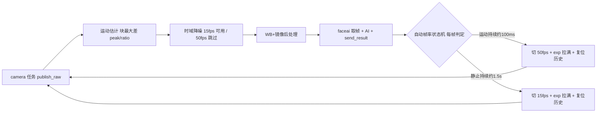

## 用户需求

1. 修复 mv 恒为 0%：用户确认静止与运动时都恒为 0%（根因已定位：摄像参数缓存只在收到 cam 命令时读取一次快照，流式结果帧一直重复该冻结值）。
2. 新增运动自适应帧率：静态画面保持 15fps，检测到运动物体自动切换到 50fps，运动结束后回落。
3. 把 UI 第 4 行的 10fps 按钮替换为"进入/退出自动调整 fps 模式"的开关按钮（10fps 仍可用命令行设置）。

## 核心功能

- 独立运动估计：不依赖降噪是否开启、在 50fps（降噪被守卫跳过）时仍能工作；输出全帧最大块间差 peak 与运动块占比 ratio
- 自动帧率状态机：静止 15fps 与运动 50fps 双向切换，带迟滞（运动持续约 100ms 才切、静止约 1.5s 才回落）与切换冷却，避免阈值边缘抖动
- 切换联动：切换后自动把曝光拉到新帧率上限、复位降噪与运动历史，避免亮度跳变被误判成运动
- 手动优先：点击 50/25/15fps 手动按钮自动退出自动模式
- 与降噪互补：静止 15fps 时降噪生效（画面干净），运动 50fps 时降噪自动跳过（无算法拖影）
- mv 实时刷新：界面结果行的运动占比随画面动静逐帧变化（静止接近 0，挥手明显升高）

## 视觉与交互效果

- UI 第 4 行变为 50fps / 25fps / 15fps / AUTO ON(或 OFF) / DN 档位；AUTO 按钮点击即进出自动模式，文字与板端状态一致
- 结果行示例 cam15fps auto mv2% dn3：auto 标记自动模式、mvNN% 实时反映运动程度、dnN 为降噪档
- 静态画面保持既有降噪后的干净观感；出现运动时画面自动切到 50fps 变流畅，无残影与画面滞留

## 技术栈

沿用现有工程栈，无新增依赖：

- 板端：ESP-IDF v5.5.5，C（app_imgpipe.c）+ C++（app_faceai.cpp），FreeRTOS，PSRAM 帧缓冲
- 链路：JCLINK v1（以太网 TCP 192.168.33.2:3333 / USB CDC），0x02 结果 JSON、0x04 日志、0x05 图像
- UI：LVGL 9.3 SDL 模拟器（WSL 编译），同源 ui_shared.c
- 验证工具：pc_host/jc_test.py（watch/cmd/img）、tools/rgb_stats.py、tools/raw2png.py

## 实现方案

### 1) 修复 mv 恒 0（根因明确，必须先修）

- 根因：app_faceai.cpp 中 s_cam_dn_mv 等缓存只在 cam 命令分支读取一次（line 778 附近的 s_cam_state_valid 块），之后流式结果帧重复该冻结快照；用户点 DN 按钮时刚好快照为 0，因此恒为 0
- 修复：抽取 cam_state_tick() 轻量刷新函数（一次 stats 结构体拷贝 + app_imgpipe_get_dn + app_camera_get_fps），在主循环每帧取到帧后调用（line 889 之后、s_running 分支之前），使所有 send_result 路径都带实时值；cam 命令分支保留原读取（命令即时反馈）

### 2) 独立运动估计（app_imgpipe，与降噪解耦）

- 状态：s_pipe 增加 mv_enabled、mv_prev 缓冲（PSRAM，stride*h 约 600KB，仅自动模式启用时按需分配，沿用 cap/stride/h 失效键）、mv_has_prev、mv_peak/mv_ratio
- 算法：与降噪同源但语义不同——8x8 块 + 4x4 下采样采样点的 G 通道差；每块取最大差 bmax；全帧统计 peak 与 ratio（bmax 达到阈值的块占比 %）；diff 算完后在块内把当前帧拷入 mv_prev
- 关键差异：降噪是 IIR（混合结果写回 prev），运动估计是每帧无条件以当前帧刷新 prev，因此不依赖降噪开关，且在 50fps（降噪被守卫跳过）时仍有效
- 成本：约 4800 块乘 16 采样 + 每帧 600KB 块拷贝；50fps 下若 mv_ms 偏高，改为隔帧估算（25Hz 运动信号足够）
- API：app_imgpipe_set_motion_detect(bool 开关)、app_imgpipe_set_motion_thr(int 块阈值)；结果并入 app_imgpipe_stats_t（mv_peak/mv_ratio/mv_ms），faceai 每帧一次结构体拷贝即可取到
- 阈值：块运动阈值默认约 30（G 通道 6bit 差；静止噪声实测块最大差多在 13 到 20），Kconfig 可调、运行时可标定

### 3) 自动帧率状态机（app_faceai，按时间而非帧数）

- 常量：IDLE 15fps、ACTIVE 50fps、MOTION_HOLD 约 100ms、IDLE_HOLD 约 1500ms、COOLDOWN 约 300ms（切换后暂停判定）
- 每帧：moving = (mv_ratio 达到 ratio 阈值)；分别累计运动与静止持续计时，满足条件即切换
- 切换动作（必须成套）：app_camera_set_fps(目标帧率) 后读回控制块并把 exp 拉到新上限（保持最亮）；app_imgpipe_reset_prev() 并复位运动估计历史；重启冷却计时；记一条低频 0x04 日志
- 开启自动模式即进入 15fps；关闭时保持当前帧率
- 边界处理：cam 命令改 exp/gain/fps/mirror 时同步复位运动历史并重启冷却；扩展 app_imgpipe_reset_prev() 使其同时复位降噪与运动两套 prev

### 4) 控制面与 UI

- 命令：{"cmd":"cam","auto_fps":true 或 false}（缺省为查询）；标定参数 {"cmd":"cam","mv_thr":N,"mv_ratio":N}；ack 的 msg 回显 auto 状态与阈值
- 结果帧新增：auto_fps(0/1) 恒带；mv（运动占比，估计器有数据时）、mv_peak（标定用）；保留既有 dn_mv 等
- UI：第 4 行 10fps 按钮改为 AUTO OFF/ON 循环按钮（id 用 "auto"，避免与 fps 前缀回调冲突；乐观更新并用结果帧 auto_fps 字段对齐）；手动帧率按钮附加 auto_fps:false；结果行追加 auto 标记与 mv（优先 mv，缺失时回退 dn_mv）

## 架构设计（自动帧率控制回环）



## 目录结构

```
jc_p4_app/
├── main/
│   ├── app_imgpipe.c      # [MODIFY] 新增运动估计模块：独立 mv_prev 缓冲（PSRAM，按 cap/stride/h 失效键管理）、
│   │                      #   8x8 块最大差统计（peak/占比）、块内拷贝刷新 prev、开关与阈值 API、
│   │                      #   统计写入 st.mv_peak/mv_ratio/mv_ms；reset_prev 扩展为同时复位降噪与运动历史
│   ├── app_imgpipe.h      # [MODIFY] 运动估计 API 声明与语义注释；stats 新增 mv_peak/mv_ratio/mv_ms
│   ├── Kconfig.projbuild  # [MODIFY] 新增 APP_CAM_MOTION_THR(默认30)、APP_CAM_MOTION_RATIO(默认5)、
│   │                      #   APP_CAM_AUTO_IDLE_FPS(默认15)、APP_CAM_AUTO_ACTIVE_FPS(默认50)；写法沿用现有 APP_CAM_* 风格
│   └── app_faceai.cpp     # [MODIFY] ① cam_state_tick() 每帧刷新统计缓存（修 mv 恒 0，主循环取帧后调用）；
│                          #   ② cam 命令加 auto_fps/mv_thr/mv_ratio 解析与回显；
│                          #   ③ 自动帧率状态机（时间迟滞、冷却、切换联动 exp 拉满与历史复位）；
│                          #   ④ 结果帧新增 auto_fps/mv/mv_peak 字段
└── docs/
    ├── HANDOVER.md        # [MODIFY] 第十节补充：mv 恒 0 根因与修法、运动估计设计、状态机参数与标定值、
    │                      #   实测数据、场景与推荐用法（自动模式 + 降噪组合）
    └── usb_link_protocol.md # [MODIFY] cam 命令表补 auto_fps/mv_thr/mv_ratio；结果帧补 auto_fps/mv/mv_peak
lvgl_project/lv_port_pc_vscode_official/
└── main/src/ui_shared.c   # [MODIFY] 第 4 行 10fps 改为 AUTO OFF/ON 循环按钮（lbl_auto 显示）；
                           #   手动帧率按钮附加 auto_fps:false 并同步 AUTO 标签；
                           #   结果行追加 auto 标记与 mv（优先 mv，回退 dn_mv）
```

## 关键代码结构

```c
/* app_imgpipe.h —— 统计与控制接口 */
uint32_t mv_peak;    /* 全帧最大块间差 0..63（标定用） */
uint32_t mv_ratio;   /* 运动块占比 0..100 % */
uint32_t mv_ms;      /* 运动估计耗时 ms */

void app_imgpipe_set_motion_detect(bool on);   /* 自动模式下启用（分配并维护独立 prev） */
void app_imgpipe_set_motion_thr(int thr);      /* 块运动阈值，默认 CONFIG_APP_CAM_MOTION_THR */

/* app_faceai.cpp —— 自动帧率状态机 */
AUTOFPS_IDLE      = 15    /* 静止目标帧率 */
AUTOFPS_ACTIVE    = 50    /* 运动目标帧率 */
AUTOFPS_MOTION_MS = 100   /* 运动持续多久判定为"在动" */
AUTOFPS_IDLE_MS   = 1500  /* 静止持续多久回落 */
AUTOFPS_COOL_MS   = 300   /* 切换后冷却，期间不判定 */
/* 每帧：cam_state_tick() 刷新缓存 -> moving 判定 -> 满足条件切换并联动复位 */
```

## 实施注意

- 修复 mv 优先单独验证：15fps 且 DN 开启时用 watch 观察 dn_mv 是否逐帧变化；镜像翻转可作"合成运动"事件用于自动化验证（该帧 peak 应跳变）
- 状态机可无物理运动双向验证：把 mv_ratio 阈值临时设为 0，静止场景会被判定为运动从而切到 50fps；恢复阈值后约 1.5s 应回落 15fps
- 切换联动缺一不可：exp 拉满（否则 50fps 下画面偏暗）、复位降噪与运动历史（否则亮度跳变被误判为运动导致来回切换）
- 性能纪律：运动估计仅自动模式下运行与分配；若 50fps 下 mv_ms 偏高改隔帧估算；禁止按帧打日志（只在切换事件记低频日志）
- 兼容性：src=pc 时 publish_raw 不运行，自动模式仅对板载摄像头有意义（文档注明）
- 构建注意：新增 Kconfig 后需 idf.py reconfigure；烧录前 chcp 65001 与 PYTHONIOENCODING=utf-8；不改 idf_component.yml 的 override_path 结构
- 物理边界：运动模糊由曝光不超过帧周期决定，软件无法消除，本方案以"运动时提高帧率"规避

## 验收标准

1. mv 实时性：DN 开启下 dn_mv 逐帧变化；自动模式下 mv 随画面动静实时变化（静置约 0 到 3%，挥手明显升高）；镜像翻转帧可见 peak 跳变
2. 自动模式：开启后稳定 15fps；触发运动（挥手或临时低阈值）后数帧内切到 50fps；运动停止约 1.5s 后回落 15fps；切换瞬间无残影（历史已复位）
3. 稳定性：自动模式连续运行 2 分钟以上，无 task_wdt、0x02 流不中断、dropped 无异常增长、无阈值边缘抖动
4. UI：AUTO 按钮可进出自动模式且状态与板端一致；手动帧率按钮会退出自动；结果行显示 auto 与实时 mv；截图存档 docs/img/
5. 文档与全局记忆同步更新